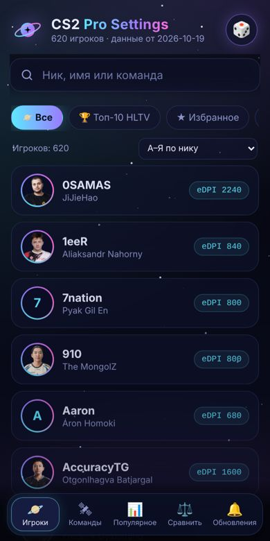
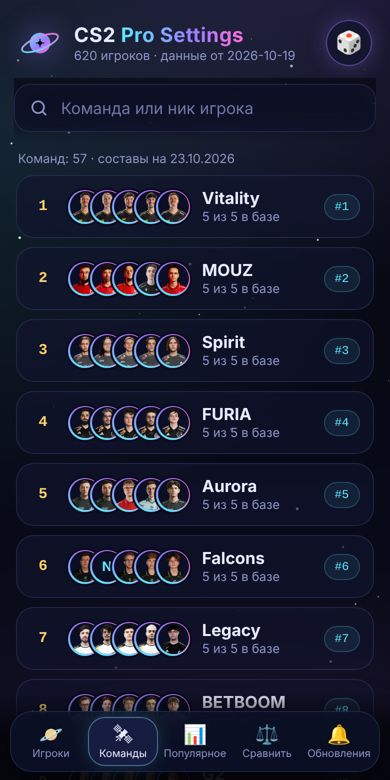
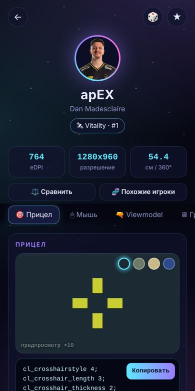
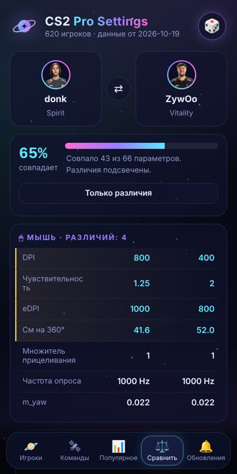
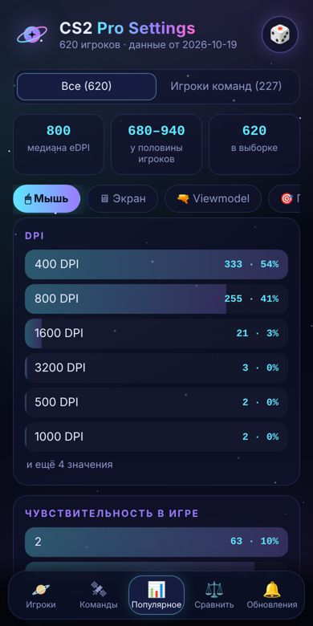
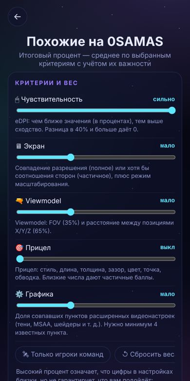

# CS2 Pro Settings — Telegram Mini App

Приложение в космической теме с настройками профессиональных игроков CS2: прицел, мышь, viewmodel, графика, HUD. Работает внутри Telegram, данные берёт из открытого проекта [cs2-pro-configs](https://github.com/AntonyPerez0/cs2-pro-configs) (MIT, источник settings.gg, 620 игроков).

| Игроки | Команды | Карточка | Сравнение | Популярное | Похожие |
|---|---|---|---|---|---|
|  |  |  |  |  |  |

## Возможности
- Поиск игроков по нику, имени и команде; топ-10 HLTV; избранное; случайный игрок (🎲).
- Карточка игрока: предпросмотр прицела, команды для консоли с копированием, мышь (eDPI, см/360°), viewmodel, видео, HUD, скачивание `.cfg`.
- **Сравнение двух игроков** по всем параметрам с подсветкой различий.
- **Подбор по параметрам** (eDPI, FOV, разрешение, прицел) и **похожие игроки** с настраиваемым весом критериев.
- **Популярные настройки** (по всем игрокам или только по игрокам команд).
- **Обновления:** журнал изменений настроек игроков.
- **Команды:** 57 команд рейтинга Valve/HLTV и их игроки.

## Файлы
| Файл | Назначение |
|---|---|
| `index.html`, `style.css`, `app.js` | само приложение (разметка, стили, логика) |
| `meta.json` | собранные признаки игроков, команды, журнал изменений |
| `state.json` | прошлый снимок настроек для поиска изменений (служебный) |
| `teams.json` | составы команд, правятся вручную |
| `build_meta.py` | сборка `meta.json` и `state.json` из клона источника |
| `.github/workflows/update-meta.yml` | автопересборка дважды в неделю |

## Запуск и обновление
1. Залейте все файлы в репозиторий и включите GitHub Pages (Settings → Pages → main, root).
2. Вставьте ссылку в `WEBAPP_URL` бота; при смене версии меняйте `?v=N`.
3. Локальная пересборка: `git clone https://github.com/AntonyPerez0/cs2-pro-configs src`, затем `python build_meta.py src`.
   `build_meta.py` проверяет данные (минимум 400 игроков, у большинства есть настройки мыши) и при ошибке не трогает `meta.json`.

## Ограничения
- Приложение зависит от внешнего источника. Если он недоступен, используется запасной адрес, затем сохранённая копия; сверху показывается предупреждение (устаревшие данные, нет `meta.json`, неполная аналитика).
- Прицелы в источнике пересчитаны сообществом в новую систему CS2 и могут отличаться от оригинала.
- Составы команд на 23.10.2026 не обновляются автоматически; 58 игроков из составов отсутствуют в базе настроек.
- Настройки в источнике меняются редко, поэтому журнал обновлений будет коротким.
- Оценка похожести сравнивает числа, а не удобство игры; веса критериев можно менять в экране «Похожие».
